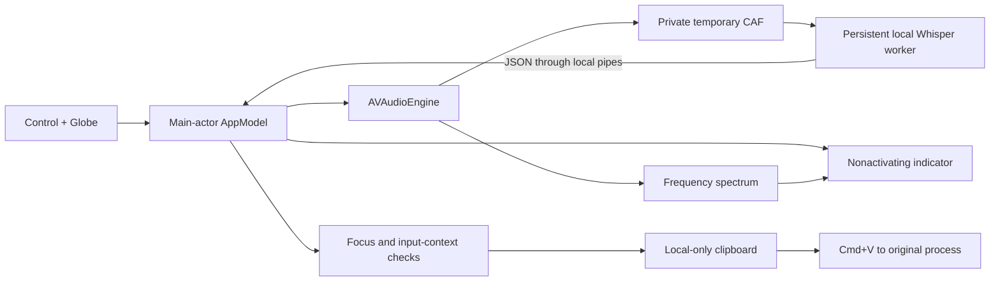

# Code audit — Dictation 0.4.0

Date: 2026-11-25. Scope: all Swift sources, Python worker, build/test scripts, package manifest, bundle configuration, documentation and the installed inference path used by this app. This is a code review with local automated and integration checks, not a certification of every macOS version or third-party editor.

## Assessment

The architecture fits this application: native SwiftUI/AppKit for interaction with macOS, AVFoundation for recording, a separate persistent Python process for the existing Whisper installation, and a small pure-Swift core for policies and DSP. No replacement framework, server or cloud dependency is needed.

The issues below were corrected before publication. No unresolved critical issue was identified in the inspected code paths. The project is suitable for source review and continued personal use. A broadly distributed signed application still needs release packaging and the manual compatibility checks listed below. The audit did not create or publish a GitHub repository.

## Data flow and boundaries

There is no socket transport between Swift and Python. The worker loads local assets and keeps the model resident. `AppModel` serializes the user workflow on the main actor. The audio session protects its file and analyzer with a lock; slow Accessibility requests run on background tasks. A request ID and process-identity checks prevent obsolete worker results from being used after cancellation or replacement.

## Findings fixed

| Priority | Finding | Change and evidence |
| --- | --- | --- |
| High | `faster-whisper` can use `Tokenizer.from_pretrained` when a local directory lacks `tokenizer.json`; `local_files_only` alone does not cover that branch. | Validate model, config, tokenizer and preprocessing assets before importing/loading the engine. Missing files fail locally. Offline environment flags remain forced; ONNX telemetry is explicitly disabled. Missing-model tests and CPU/GPU runs with network denied pass. |
| Medium | Two dictations less than one second apart could snapshot the first transcript as the “original” clipboard. | Added one clipboard restoration owner that retains the original snapshot across overlapping writes. Tests verify rich text restoration, manual copies and newer user changes. |
| Medium | Clipboard writes could participate in Universal Clipboard. | All dictation, fallback and manual-copy writes use AppKit's `currentHostOnly` option. The same restriction applies to restoration. |
| Medium | Accessibility checks before insertion could block the UI and delay input monitoring; the modifiers/app check could be stale by the time ⌘V was posted. | Run field/window queries off the main actor, allow queued input events to run, and recheck context, frontmost PID, permissions and physical modifiers immediately before sending. If the clipboard changes in that interval, retain the transcript in the app instead of overwriting the newer value. |
| Medium | The error path could leave a pending insertion task alive. | Errors cancel insertion/capture tasks, clear the request and cancel the current hold. Cancel after recognition has already completed no longer reloads the model unnecessarily. |
| Medium | Microphone permission revocation was not treated like Accessibility revocation. | Cancel an active operation when either required permission is lost. Remove input monitors when Accessibility is unavailable. Permission/audio timers use common run-loop modes, including menu tracking. |
| Medium | A write error immediately before key release could be missed before submitting the file. Audio channel processing also assumed a particular PCM layout. | Carry the capture failure flag through finalization, reject unsupported/mismatched formats, close the file before inference and ignore late callbacks. Native CAF frame counts, stereo analysis, late callbacks and invalid formats are tested. |
| Medium | A malformed non-object JSON request could crash the Python error handler itself. | Validate the request envelope and field types; retain a separate safe request ID. Malformed requests return structured errors and the next valid request succeeds. |
| Medium | A force-quit parent could leave the worker doing native inference until it returned to stdin. | Add a parent-liveness watchdog. A subprocess test kills the parent and verifies that the worker exits. Normal stop retains SIGTERM plus delayed SIGKILL fallback. |
| Low | Releasing an extra modifier while Control + Globe remained held could start a second recording. | Require a chord-key release before rearming after an extra modifier. Covered by the shortcut state-machine tests. |
| Low | Saved invalid device/beam settings could create unsupported engine arguments. | Normalize stored values to supported options at initialization. Covered by model tests. |
| Low | Worker protocol failures could be ignored until a timeout, and the input buffer was unbounded. | Validate ready/result messages and cap accumulated protocol data at 8 MiB. Tests cover split UTF-8, a single active request, timeout/restart and malformed output. |

## Requested product changes

- English is the primary documentation and interface language. `README.ru.md` provides Russian documentation.
- `System / English / Русский` selects the interface independently of speech language. System mode uses Russian only when the primary preferred macOS language is Russian. The explicit choice persists and updates the UI without restarting the model.
- English and Russian catalogs cover menus, settings, indicators, application errors and microphone permission descriptions. Dynamic messages retain their translation key, so existing status text updates too. Third-party diagnostic details and system permission UI follow their own language rules.
- A dedicated **Zero Internet Connection** section describes local processing, lack of servers/telemetry, temporary audio, memory-only transcript retention and the boundary with other apps.
- Removed unused audio-level state. Kept the tested spectrum and nonactivating panel rather than replacing working UI components.
- Added isolated app-layer tests, Python runtime tests, a reproducible network-denial test, tested dependency versions and exclusions for private configuration/virtual environments.

## Verification evidence

| Check | Result |
| --- | --- |
| Swift tests | 41 passed: 31 core tests and 10 app-layer tests. |
| Python unit tests | 5 passed: protocol, incomplete local model, translation coverage, network-audit guard and parent exit. |
| Real model, MPS FP16, beam 5, all network denied | Ready/warmup, silence, missing file, Russian speech, worker reuse and clean EOF shutdown passed; no Python socket/DNS attempts. Synthetic speech recognition: 0.463 s. |
| Real model, CPU INT8, beam 5, all network denied | Same checks passed; no Python socket/DNS attempts. Synthetic speech recognition: 5.348 s. |
| Model changes through AppModel | CPU → GPU, rapid CPU → GPU replacements and beam-size reload passed; the worker reported the requested actual backend. Test preferences were isolated from the user's settings. |
| Running app/worker socket snapshot | No Internet sockets reported by `lsof` for the inspected processes. This is a point-in-time observation; the network-denial integration tests provide the stronger runtime check. |
| English/Russian visual check | Rendered the actual settings views and overlay in both languages; checked the language selector and layout. |
| Release bundle | Build, embedded worker/translations, plist validation and ad-hoc signature verification pass. |
| Python and shell syntax | Python compilation, `bash -n`, and localization/property-list validation pass. |
| Publication scan | No credentials or private keys found in the publishable sources/configuration. No model weights, recordings or Python environment are part of the source project. Build/test artifacts remain under ignored `.build/` and `dist/`. |

The speech fixture is a short, synthetic Russian phrase, not microphone data or a quality benchmark. Timings cover worker transcription after readiness, not a guarantee for long speech or end-to-end UI latency. GPU validation was on the available Apple M5 Ultra Mac with the installed CTranslate2 build. Both backends recognized the expected phrase.

Run `bash scripts/test.sh` and the documented `scripts/test_worker.py --deny-network` commands to reproduce the main checks. Clipboard tests use unique named pasteboards, never the user's general clipboard. They require a macOS pasteboard service; a restricted automation sandbox initially blocked that service, and the tests passed when run in the normal user context.

## Remaining limitations and follow-up work

1. **Manual input/device coverage.** Physical Control/Globe combinations, microphone disconnection, sleep/lock, multiple monitors/fullscreen and insertion into each third-party editor still require manual acceptance on the final app. This audit does not claim a new end-to-end Codex UI test. Earlier user-confirmed insertion behavior is preserved by the policy tests and window fallback.
2. **Insertion is best effort.** macOS provides no universal acknowledgement that an arbitrary editor consumed ⌘V. Electron fallback deliberately trades strict AX identity for unchanged-window/context checks. Programmatic focus changes that expose no Accessibility distinction cannot be ruled out completely. The transcript remains available for manual copying.
3. **Real-time audio work.** The tap currently writes the CAF file and computes the spectrum under a short shared lock. This is simple and tested, but slow storage or unusual audio hardware could cause dropouts. Before expanding hardware support, profile capture under load and consider a bounded audio queue with an explicit overflow policy. No unbounded audio queue was introduced during this audit.
4. **Swift concurrency modernization.** The app uses Swift 5 language mode. An additional complete-concurrency diagnostic build found two warnings for `AudioRecorder` captures in main-run-loop timer/notification closures. Those callbacks are scheduled on the main thread; the audio callback shares only the locked session. A future Swift 6 migration should encode this lifecycle isolation in types rather than add unchecked annotations. The older audio tap API also receives a macOS 27 deprecation warning; it is retained for macOS 14 compatibility.
5. **External inference runtime.** MPS is marked experimental by the installed CTranslate2 build. A clean-machine installer and a full transitive dependency lock are not provided; `requirements.txt` records tested key versions. CPU remains an explicit alternative. Do not promise MPS support from a version number alone.
6. **Numerical library diagnostics.** The installed NumPy/faster-whisper combination emitted `matmul` runtime warnings. Separate checks found finite mel features for silence and the speech fixture, and both real recognizers passed. This audit does not establish the cause of those library warnings or suppress them; broader audio regression coverage is advisable before changing that runtime.
7. **Local retention after crashes.** A force-quit can leave the private temporary audio folder. Normal completion/cancel/error/exit deletes it. There is no recording history database or transcript log. Automatic crash-recovery cleanup would need an ownership/age policy to avoid deleting another live instance's recording.
8. **Distribution.** Ad-hoc signing is appropriate for this local build. Developer ID/notarization, installation outside a development folder, a selected source license and clean-machine validation remain release work. No license was invented, certificate uploaded or repository created as part of the audit.

The no-network statement applies to Dictation's runtime behavior with the inspected local dependencies. It does not cover initial tool/model installation, arbitrary replacements of the Python environment, macOS services or applications receiving the pasted text. Dictation does not act as a system-wide firewall.
